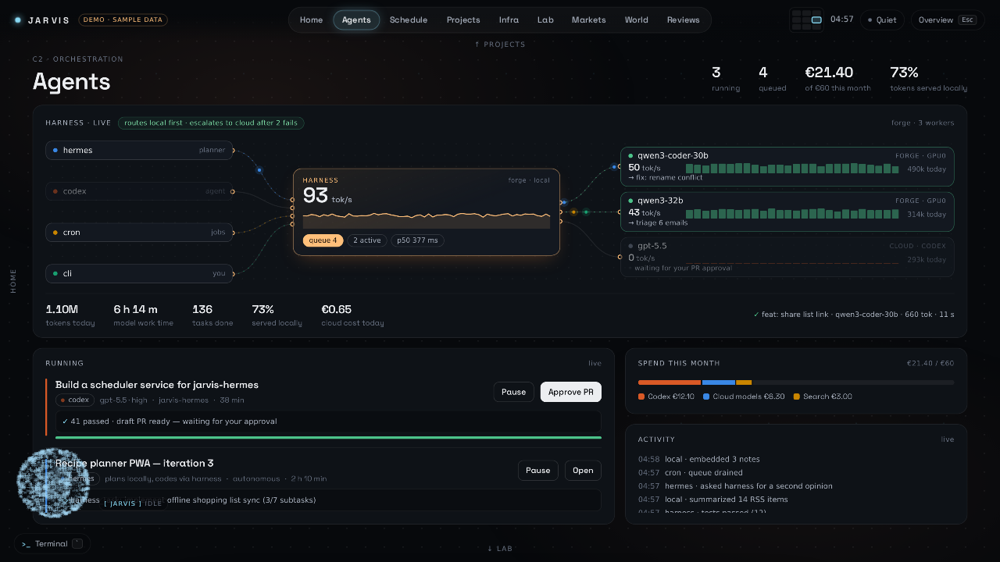
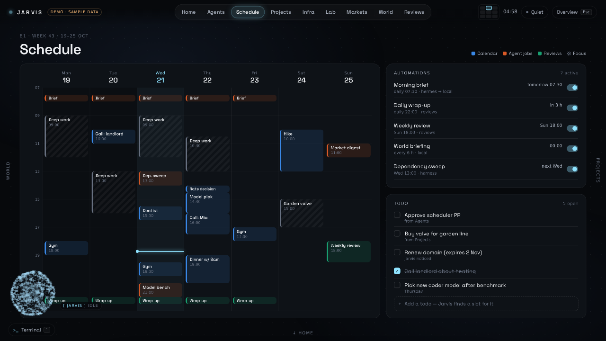
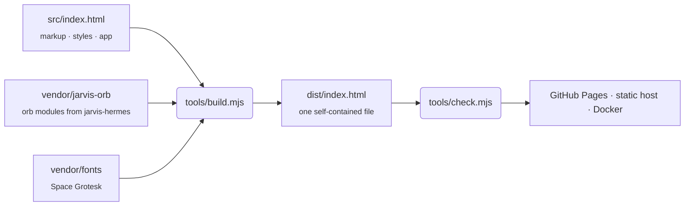

<div align="center">

# JARVIS · Center Dashboard

**A home and infrastructure command center, laid out as one living board.**<br>
Agents, schedule, projects, servers, local AI, markets, world news and reviews, with an AI companion that moves with you.

[](https://github.com/schpeterzon/center-dashboard/actions/workflows/deploy.yml)


[Features](#features) · [Quick start](#quick-start) · [Controls](#controls) · [How it works](#how-it-works) · [Deploy](#deploy)

<br>


</div>

<br>

## Overview

Center Dashboard is the front end of a personal JARVIS setup. Instead of tabs that swap pages, the whole dashboard is **one large board** split into nine panes. Moving between them flies a camera across the board, so you always know where you are and what sits next door.

The **JARVIS orb**, the same WebGL particle orb as in [jarvis-hermes](https://github.com/schpeterzon/jarvis-hermes), lives on top of the board as a companion. It follows you from pane to pane, reacts to what is happening, speaks in short bubbles and asks before it acts.

> [!NOTE]
> This is a **front-end demo with sample data**. Nothing is connected to a backend yet; every number, event and action is simulated so the interface can be designed and evaluated as if it were live.

<br>

<table>
  <tr>
    <td width="50%"></td>
    <td width="50%"></td>
  </tr>
  <tr>
    <td align="center"><sub><b>The board.</b> Press <code>Esc</code> to zoom out to all nine panes.</sub></td>
    <td align="center"><sub><b>Harness · live.</b> Which agent is using which model, right now.</sub></td>
  </tr>
</table>

## Features

### A board instead of pages

- **Spatial navigation:** nine panes on a 3×3 grid, with Home in the centre. A spring-driven camera pulls back on longer jumps and settles softly.
- **Overview:** zoom out to the whole board and click any tile to fly straight into it.
- **Direct manipulation:** drag empty space or swipe on a trackpad; a quick flick carries you to the next pane, and edge labels let neighbours peek in.
- **Arrival:** the destination lights up, its cards assemble one after another and its charts draw themselves.

### JARVIS, the companion

- **The real orb** from jarvis-hermes, rendered at its true on-screen size so the particle texture holds up everywhere.
- **It moves with you:** large in the Home hero, docked in a corner on other panes, above the terminal while you talk to it.
- **States you can read:** thinking, using tools, waiting for approval, success. Its colour and the dot in the top bar follow along.
- **Speech:** contextual remarks per pane, scripted moments (*"Codex finished the scheduler — the PR just needs your nod"*), and buttons that actually do things.
- **Playful but polite:** drag it to any corner; in its dock it dodges the cursor until you catch it. A **Chatty / Quiet** switch mutes unprompted speech.

### Nine panes

| Pane | What it shows |
| --- | --- |
| **Home** | Greeting, glance chips, what needs your approval, today's timeline, agents, portfolio, machines, headlines |
| **Agents** | Live Harness routing widget, running agent tasks, monthly spend, activity feed |
| **Schedule** | Week calendar mixing events, agent jobs, reviews and focus blocks; automations with on/off switches; todos |
| **Projects** | Autonomous build pipeline (idea → shipped), live build log, autonomy rules for what JARVIS may do alone |
| **Infra** | Machines with live CPU sparklines, services, events, backups, staged fixes |
| **Lab** | Local model throughput, VRAM by model, Harness queue, routing policy, tonight's benchmark |
| **Markets** | Portfolio chart with range filters, allocation against target, holdings, suggestions that need approval |
| **World** | Briefing ranked by relevance to you, what's coming up, JARVIS' take |
| **Reviews** | Weekly review write-up, progress toward this week's goals, review history |

### Harness · live

A real-time view of the local AI fabric. **Sources** (hermes, codex, cron, cli) hand work to the **Harness**, which routes it to a **model**: two local models on the GPU server, or the cloud when a task escalates. Packets travel the actual routes. Each model shows tokens/s, a throughput history, tokens today and its current job. The footer tracks tokens, work time, tasks done, local share and cloud cost.

<p align="center"></p>

### Built for real screens

Every pane is designed on a 900 px-tall canvas that scales to the viewport, while its width follows the screen shape:

| Screen | Example | Design width |
| --- | --- | --- |
| 16:10 laptop | 1280×800, 1440×900, 1920×1200 | ≈ 1440 |
| 16:9 | 1366×768, 1920×1080 | 1600 |
| 21:9 ultrawide | 2560×1080, 3440×1440 | ≈ 2130, content capped at 2000 |

It also respects `prefers-reduced-motion`, falls back gracefully without WebGL, and drops the heavier entrance animations automatically on slow machines.

## Quick start

Requires **Node.js 20.11+**. There is nothing to install.

```sh
git clone https://github.com/schpeterzon/center-dashboard.git
cd center-dashboard
npm run preview        # build + serve on http://127.0.0.1:8080
```

The build output is a single self-contained `dist/index.html` (about 400 KB) with the orb, the font and all code inlined. It also works when opened straight from disk.

| Command | Description |
| --- | --- |
| `npm run build` | Build `dist/index.html` from `src/` and `vendor/` |
| `npm run check` | Build, then run the static checks |
| `npm run preview` | Build and serve `dist/` locally |
| `npm run sync-orb` | Refresh the vendored orb and font from `../jarvis-hermes`, then build |

## Controls

| Action | Input |
| --- | --- |
| Go to a pane | Tabs, keys <kbd>1</kbd>–<kbd>9</kbd>, or the board map in the top bar |
| Move to a neighbour | Arrow keys, edge labels, trackpad swipe, mouse wheel |
| Pan freely | Drag empty board space, or hold <kbd>Space</kbd> and drag |
| Overview | <kbd>Esc</kbd>, or pinch in on a trackpad |
| Terminal | <kbd>`</kbd> (try `help`, `status`, `plan my week`, `go lab`) |
| Talk to JARVIS | Click the orb |
| Charge the orb | Press and hold it |
| Move the orb | Drag it to any corner |

## How it works



- **No framework, no dependencies.** The app is plain HTML, CSS and JavaScript in `src/index.html`.
- **The orb is vendored, not forked.** `vendor/jarvis-orb/` is a copy of the orb modules from jarvis-hermes (the commit is recorded in `SOURCE`). The build wraps them in a tiny module registry, so the result runs as a classic script, including from `file://`.
- **Static checks guard the build.** `tools/check.mjs` verifies that every inline script parses, every element the script looks up exists, ids are unique, the navigation matches the panes, nothing loads from a remote origin and the file stays under its size budget.

```text
src/index.html          the app: markup, styles and script
vendor/jarvis-orb/      orb modules vendored from jarvis-hermes
vendor/fonts/           Space Grotesk and its licence (OFL)
tools/build.mjs         inlines orb + font into dist/index.html
tools/check.mjs         static checks for the built page
tools/serve.mjs         local preview server
docs/screenshots/       images used in this README
.github/workflows/      build, check and deploy
Dockerfile              nginx image for self-hosting
```

## Deploy

**GitHub Pages:** the workflow in `.github/workflows/deploy.yml` builds and checks every push and pull request. To publish, open **Settings → Pages** and set **Source** to **GitHub Actions**; every push to `main` then deploys automatically.

**Static hosts** (Netlify, Vercel, Cloudflare Pages): use the build command `npm run check` and the output directory `dist`.

**Self-hosted with Docker:**

```sh
docker build -t center-dashboard .
docker run -d -p 8080:80 --name center-dashboard center-dashboard
```

**Anywhere else:** copy `dist/index.html` behind any web server; it has no other files.

## Roadmap

- Connect the panes to the JARVIS API and event stream from jarvis-hermes instead of sample data
- Feed the Harness widget from real Harness telemetry
- Persist approvals, todos and automations
- Authentication for anything beyond a private network

## Credits

- **JARVIS orb** from [jarvis-hermes](https://github.com/schpeterzon/jarvis-hermes)
- **Space Grotesk** by [The Space Grotesk Project Authors](https://github.com/floriankarsten/space-grotesk), licensed under the [SIL Open Font License](vendor/fonts/OFL.txt)
