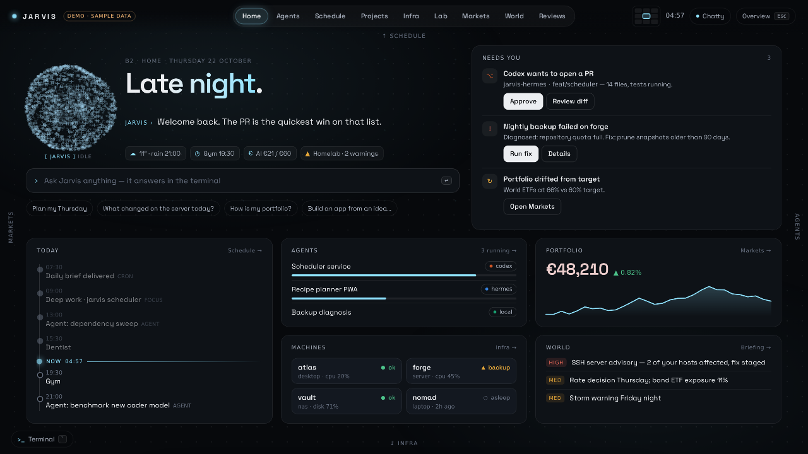
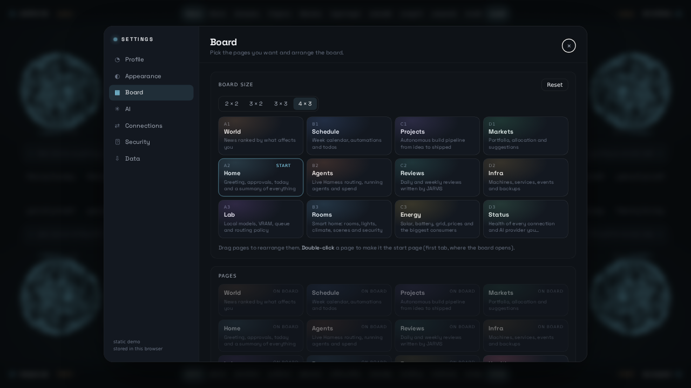
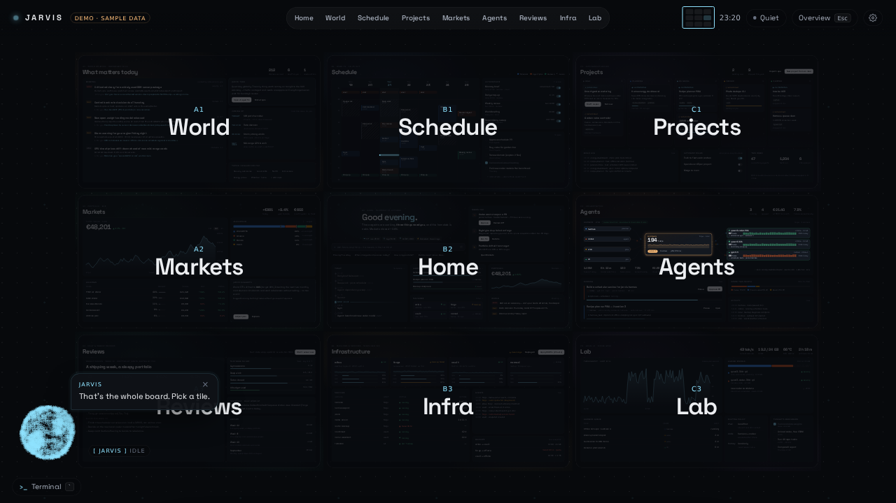
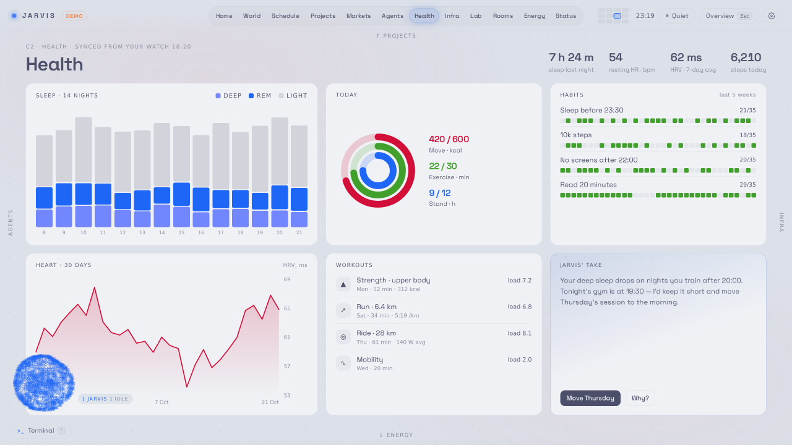
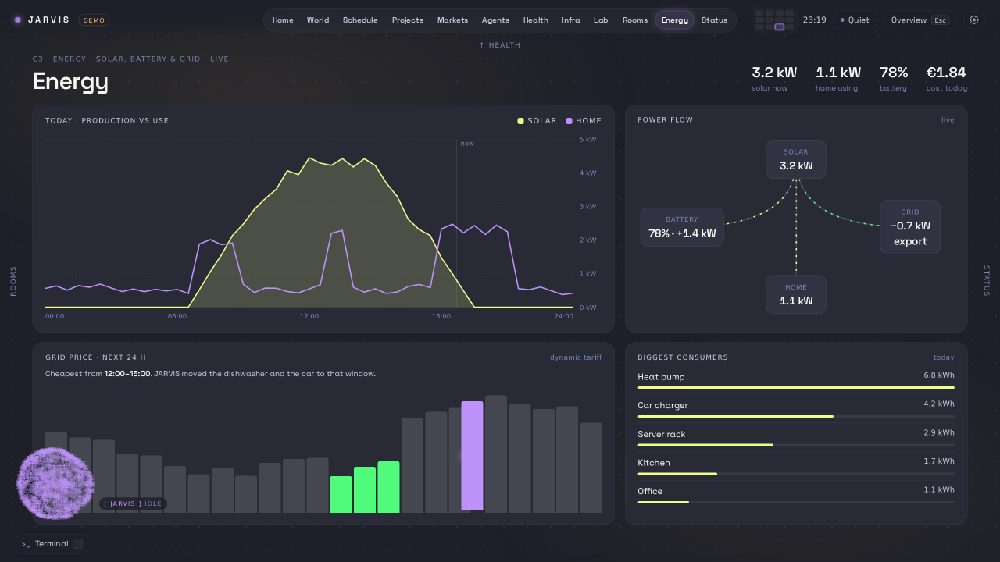
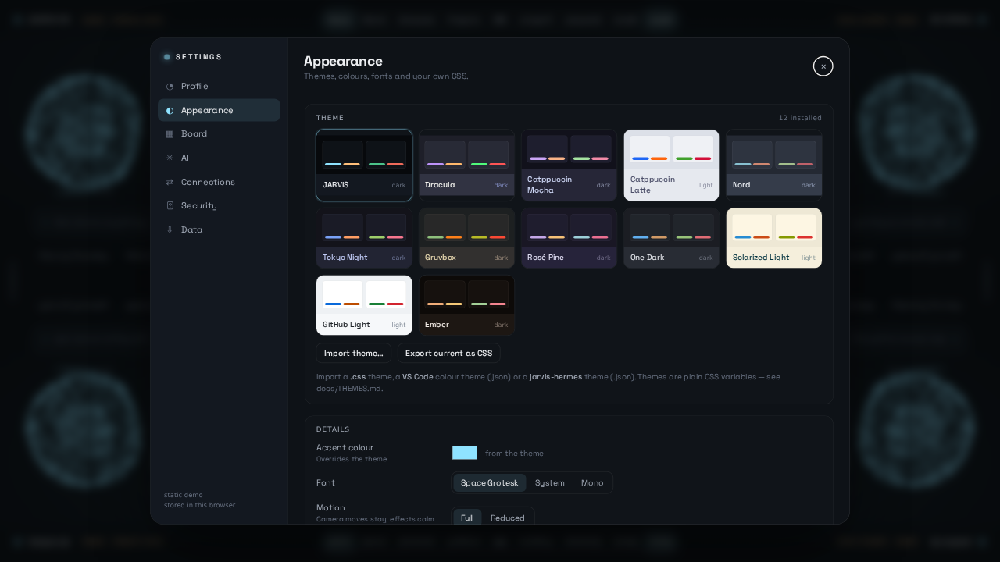
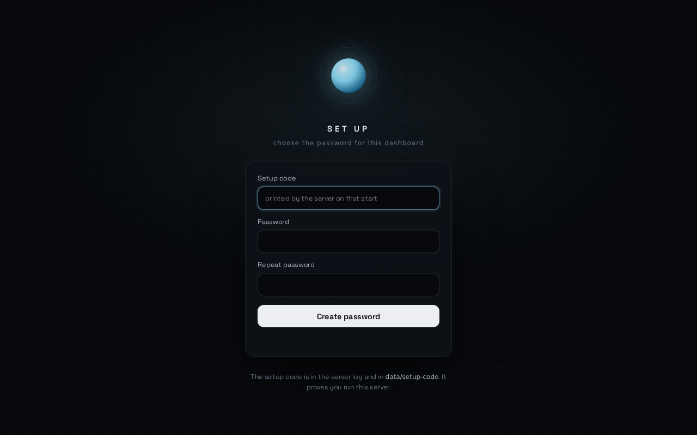
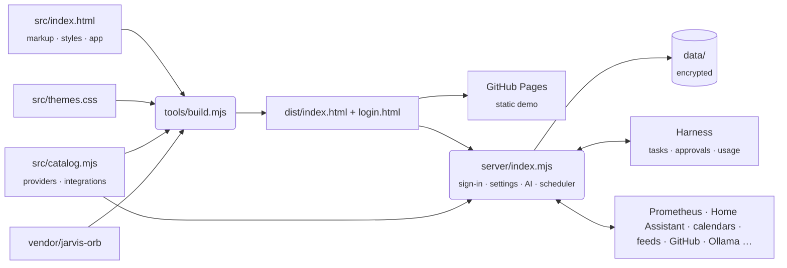

<div align="center">

# JARVIS · Center Dashboard

**A personal home and infrastructure command center, laid out as one living board.**<br>
Agents, schedule, projects, servers, smart home, energy, health, markets, news and more, with an AI companion that moves with you. Bring your own AI: a Claude subscription, any API key, or a model running at home.

[](https://github.com/schpeterzon/center-dashboard/actions/workflows/deploy.yml)


[Features](#features) · [Try the demo](#try-the-demo) · [Run it privately](#run-it-privately) · [Expose it with Cloudflare](#expose-it-with-cloudflare) · [AI](#bring-your-own-ai) · [Themes](#themes)

<br>



</div>

<br>

## Overview

Center Dashboard is a front end for a personal JARVIS. Instead of tabs that swap pages, the whole dashboard is **one large board**. Moving between pages flies a camera across it, so you always know where you are and what sits next door. You choose which pages are on the board and where.

The **JARVIS orb**, the WebGL particle orb from [jarvis-hermes](https://github.com/schpeterzon/jarvis-hermes), lives on top of the board. It follows you, reacts to what happens, speaks in short bubbles, asks before it acts and takes its colours from your theme.

It runs two ways:

| | Static demo | Private server |
| --- | --- | --- |
| What | One HTML file with sample data | The same app behind a sign-in |
| Start | open `dist/index.html`, or GitHub Pages | `npm start`, or Docker |
| Settings | saved in your browser | saved on your server |
| Data | sample data on every page | your own: Harness, calendars, Prometheus, Home Assistant, feeds, GitHub… |
| AI and connections | — | Claude subscription, API keys, local models; ChatGPT subscription opt-in |
| Who sees it | everyone (nothing personal in it) | only you; visitors get a blank login page |

### What each page reads

On the server every page renders from live data, refreshed every 15 seconds. Harness changes (a new task, a status change, an approval request) arrive at once: the server follows the Harness WebSocket and pushes each change to open boards. A page whose source is not connected says which connection it needs, instead of showing anything made up.

| Page | Live from | What you can do there |
| --- | --- | --- |
| **Home** | everything below | approve or reject agent requests, re-run failed tasks, see today, machines, headlines |
| **Agents** | Harness | live routing graph, running tasks, approve / reject / cancel, start a new task |
| **Schedule** | ICS calendars, JARVIS | week view, automations (brief, reviews, Harness tasks, AI prompts on a schedule), todos |
| **Projects** | Harness, GitHub | kanban from agent tasks and pull requests, ideas you can hand to an agent |
| **Infra** | Prometheus, Proxmox VE, Uptime Kuma, JARVIS (hermes), Custom HTTP | CPU / RAM / disk / GPU per machine and node, VMs and containers, scrape targets, monitors and endpoints, JARVIS' event log |
| **Lab** | Prometheus, Harness, Ollama | GPU load, VRAM, temperature, local models loaded and on disk, GPU queue, workers |
| **Rooms** · **Energy** | Home Assistant, Jellyfin | rooms, lights, scenes, climate, locks, what is playing · power flow, consumers, energy counters |
| **World** | RSS / Atom feeds | headlines ranked by your topics, the coming week, a summary on request |
| **Reviews** | JARVIS + your AI | daily and weekly reviews written from your real week, the morning brief |
| **Markets** | Finnhub + your holdings | value, allocation against targets, drift suggestions (never trades) |
| **Inbox** | Email (IMAP), Harness, GitHub, Home Assistant | unread mail (read-only), approvals, pull requests, notifications and failures in one place |
| **Network** | Prometheus, Tailscale, AdGuard, Cloudflare | bandwidth, devices, DNS blocking, which hostnames Access protects |
| **Insights** | Harness | tokens per day by provider, model usage, activity, agent time by worker |
| **Status** | every connection | health and latency of each connection, checked from the server |
| **Health** | Home Assistant | steps over two weeks, heart rate today, sleep, weight: whatever your phone (companion app, Health Connect) or wearable integration reports |

> [!NOTE]
> Mail is read with IMAP `EXAMINE`, so nothing is marked as read, and only headers are fetched. Proxmox with its self-signed certificate works when you paste the certificate's SHA-256 fingerprint (Settings → Connections → Proxmox → Advanced); without it the certificate must be trusted.

> [!NOTE]
> JARVIS sees the same live summary when you ask it something, and can **suggest** actions (a todo, a Harness task, an approval). Nothing happens until you click the suggestion.

## Features

### A board you arrange

- **Sixteen pages** to choose from: Home, Agents, Schedule, Projects, Infra, Lab, Markets, World, Reviews, plus **Rooms** (smart home), **Energy**, **Health**, **Inbox**, **Network**, **Insights** (statistics) and **Status** (live connection health).
- **Settings → Board**: pick 2×2, 3×2, 3×3 or 4×3, drag pages between slots, drop new ones in from the library, double-click to choose the start page. The board, tabs, minimap and coordinates rebuild live behind the panel.
- **Spatial navigation**: a spring-driven camera pulls back on longer jumps; zoom out to the whole board with <kbd>Esc</kbd>; drag, swipe or flick between neighbours.

<table>
  <tr>
    <td width="50%"></td>
    <td width="50%"></td>
  </tr>
  <tr>
    <td align="center"><sub><b>Settings → Board.</b> Drag, drop, resize, pick a start page.</sub></td>
    <td align="center"><sub><b>The board.</b> <kbd>Esc</kbd> zooms out to every page.</sub></td>
  </tr>
</table>

### Themes, down to your own CSS

- **12 built-in themes**: JARVIS, Dracula, Catppuccin Mocha and Latte, Nord, Tokyo Night, Gruvbox, Rosé Pine, One Dark, Solarized Light, GitHub Light and Ember. Light themes included.
- **Import** a theme as CSS, a **VS Code colour theme** (.json) or a **jarvis-hermes theme** (.json). **Export** the current one as CSS.
- **Custom CSS** that runs after every theme, plus accent colour, font and motion settings.
- A theme is ~15 CSS variables; everything else is mixed from them, including the orb. See [docs/THEMES.md](docs/THEMES.md).

<table>
  <tr>
    <td width="50%"></td>
    <td width="50%"></td>
  </tr>
  <tr>
    <td align="center"><sub><b>Health</b> in Catppuccin Latte.</sub></td>
    <td align="center"><sub><b>Energy</b> in Dracula. The orb follows the theme.</sub></td>
  </tr>
</table>

### Bring your own AI

Pick how JARVIS thinks in **Settings → AI**. Any one of these is enough:

| | Options | How |
| --- | --- | --- |
| **Subscription** | Claude Pro/Max · ChatGPT Plus/Pro (opt-in) | through the official `claude` or `codex` CLI, signed in once on the server |
| **API key** | Anthropic · OpenAI · Google Gemini · OpenRouter · Mistral · Groq · xAI · DeepSeek | pay per token |
| **Local** | Ollama · LM Studio · llama.cpp · vLLM · any OpenAI-compatible server | nothing leaves your network |

Every connection has a **Test** button that lists the available models. Answers stream into the terminal (<kbd>`</kbd>) and the Home prompt, with the route shown on every reply. Claude Code runs text-only, with every tool disabled; API and local model requests carry no tool definitions. Codex CLI cannot switch its shell tool off, so the ChatGPT subscription is **opt-in** (`JARVIS_ALLOW_TOOL_CLIS=1`): it then runs in a read-only sandbox without network, web search, browser or apps, and untrusted headlines are left out of its prompt. Gemini CLI stays unavailable until it can be locked down the same way.

### Connections

**Settings → Connections** stores what JARVIS reads from: the Harness, jarvis-hermes, Home Assistant, Ollama, weather (no key), Prometheus, Proxmox VE, Uptime Kuma, AdGuard Home, Tailscale, Cloudflare, GitHub, any ICS calendar, RSS feeds, Finnhub, Jellyfin, ntfy, or any HTTP endpoint. Each one is tested from the server and watched on the **Status** page. Secrets are encrypted on the server and never sent back to the browser.

The **Infra** page and Home machine tiles can show live CPU, RAM, root filesystem use and uptime from Prometheus. Add a Prometheus connection in **Settings → Connections**; its server URL and optional bearer token stay on the dashboard server. Prometheus must scrape node_exporter for machine readings. NVIDIA GPU utilisation, memory, temperature and power appear with either the DCGM exporter or nvidia_gpu_exporter; exporters on the same host are shown as one machine.

<p align="center"></p>

### Private by default

- Visitors without a session get a **neutral login page** and nothing else: no name, no data, not even the app.
- First run is claimed with a **setup code** printed by the server, so finding the URL first is not enough.
- scrypt passwords, optional **two-factor codes**, rate limits, revocable sessions, a hash-based **Content Security Policy**, and optional **Cloudflare Access** verification on every request. Details in [SECURITY.md](SECURITY.md).

### JARVIS, the companion

- **The real orb** from jarvis-hermes, rendered at its true size and coloured by the theme.
- **It moves with you:** large in the Home hero, docked in a corner elsewhere, above the terminal while you talk.
- **Speech** in bubbles, with buttons that do things. A **Chatty / Quiet** switch mutes unprompted remarks.
- **Playful but polite:** drag it to any corner; in its dock it dodges the cursor until you catch it.

### Built for real screens

Every page is designed on a 900 px-tall canvas that scales to the viewport, while its width follows the screen shape: 16:10 laptops (≈1440), 16:9 (1600) and 21:9 ultrawides (≈2130, content capped at 2000). It respects `prefers-reduced-motion`, falls back gracefully without WebGL and calms its animations on slow machines.

## Try the demo

Requires **Node.js 20.11+**. There is nothing to install.

```sh
git clone https://github.com/schpeterzon/center-dashboard.git
cd center-dashboard
npm run preview        # static demo on http://127.0.0.1:8080
```

The build is a single self-contained `dist/index.html` (about 620 KB, with the orb, font and themes inlined). It also works opened straight from disk. Settings in the demo are kept in your browser.

## Run it privately

```sh
npm start              # build + server on http://127.0.0.1:8790
```



1. The first start prints a **setup code** (also in `data/setup-code`).
2. Open the URL, enter the code and choose a password.
3. Open **Settings** (<kbd>,</kbd> or the gear) → **AI** and connect a subscription, a key or a local model. To use Claude, install its CLI on the same machine and sign in once (`claude`).
4. Press <kbd>`</kbd> and ask JARVIS something.

Everything lives in `data/` (settings, encrypted secrets, sessions, todos, reviews). Back it up as a whole. Forgot the password? `npm run reset-password`.

Automations run on the server: by default a morning brief (07:30), a daily wrap-up (weekdays 21:30) and a weekly review (Sunday 18:00), all editable on the Schedule page. Add an **ntfy** connection to get them, new approvals and failed tasks on your phone. Agent work itself always runs in the Harness; the dashboard only schedules and asks.

<br clear="right">

**On NixOS** (the repository is a flake):

```nix
# flake.nix
inputs.center-dashboard.url = "github:schpeterzon/center-dashboard";

# configuration
imports = [ inputs.center-dashboard.nixosModules.default ];
services.center-dashboard = {
  enable = true;                       # http://127.0.0.1:8790, state in /var/lib/center-dashboard
  environmentFile = "/etc/secrets/center-dashboard.env";   # optional: CF_ACCESS_*, JARVIS_AUTH, …
  trustProxy = true;                   # behind a Cloudflare Tunnel
  # user = "you"; cliPackages = [ pkgs.claude-code ];       # to use your Claude subscription
};
```

Then `journalctl -u center-dashboard` shows the setup code. The service is sandboxed (no home access, read-only system, no capabilities) unless you run it as your own user for a subscription CLI.

**With Docker:**

```sh
docker build -t jarvis-dashboard .
docker run -d --name jarvis -p 127.0.0.1:8790:8790 -v jarvis-data:/data jarvis-dashboard
docker logs jarvis     # shows the setup code
```

The image covers API keys and local models. Subscription CLIs are easiest with `npm start` or the NixOS module running as a user who is already signed in.

**Try the live board without your own services:** `npm run fixtures` starts stand-ins on port 18800: a calendar (`/cal.ics`), Home Assistant with health sensors (token `ha-token`), Uptime Kuma, AdGuard, Jellyfin (key `jf-key`), a jarvis-hermes server (token `jarvis-token`) and a JSON endpoint (`/status.json`), plus an IMAP mailbox on 18801 (`me` / `mail-pass`) and Proxmox on https://127.0.0.1:18802 with a self-signed certificate. It prints the fingerprint to paste.

## Expose it with Cloudflare

Reach it from anywhere without opening a port:

1. **Tunnel.** In Cloudflare Zero Trust → Networks → Tunnels, create a tunnel and point a public hostname (for example `jarvis.example.com`) at `http://localhost:8790`, or use the included `docker-compose.yml` with `TUNNEL_TOKEN` in `.env`.
2. **Access** (recommended). Add an Access application for the hostname that only allows your email. Then set `CF_ACCESS_TEAM_DOMAIN` and `CF_ACCESS_AUD`: the server verifies Cloudflare's signed token on every request and refuses anything without it.
3. Set `JARVIS_TRUST_PROXY=cloudflare`. Keep the password as a second factor, or set `JARVIS_AUTH=access` to sign in through Access alone (Google, GitHub, one-time PIN…).

All options are in [`.env.example`](.env.example); the threat model is in [SECURITY.md](SECURITY.md).

## Controls

| Action | Input |
| --- | --- |
| Go to a page | Tabs, keys <kbd>1</kbd>–<kbd>9</kbd>, or the board map in the top bar |
| Move to a neighbour | Arrow keys, edge labels, trackpad swipe, mouse wheel |
| Pan freely | Drag empty board space, or hold <kbd>Space</kbd> and drag |
| Overview | <kbd>Esc</kbd>, or pinch in on a trackpad |
| Settings | <kbd>,</kbd> or the gear |
| Terminal | <kbd>`</kbd> (`help`, `go energy`, `theme nord`, `settings`, `task …`, `todo …`, `approve …`, or ask anything) |
| Talk to JARVIS | Click the orb |
| Move the orb | Drag it to any corner |

## How it works



- **No framework, no dependencies**, front end or server. Plain HTML, CSS and JavaScript, and Node's standard library.
- **One catalog** (`src/catalog.mjs`) describes every AI provider and integration: its fields, which are secret, and how to test it. The browser renders forms from it; the server validates, stores and probes with it. Adding an integration is one entry.
- **The orb is vendored** from jarvis-hermes (commit in `vendor/jarvis-orb/SOURCE`) and bundled into a classic script, so it works from `file://`.
- **Checks guard every build**: `npm test` builds, runs static checks on the page (every script parses, every looked-up element exists, no remote code, size budget, themes and catalog present, login page free of app content) and runs end-to-end tests (sign-in, secrets at rest, request guards, AI streaming, every live source against a fake Harness and fixtures, approvals, Home Assistant action limits, the ICS and feed parsers).

```text
src/index.html          the app: markup, styles and script
src/themes.css          built-in themes
src/catalog.mjs         AI providers and integrations
src/login.html          the neutral sign-in page
server/                 zero-dependency Node server: auth, live sources, Harness, scheduler
nix/                    Nix package and NixOS module (flake.nix)
tools/                  build, checks, tests, static preview
vendor/                 the JARVIS orb and Space Grotesk
docs/                   themes guide and screenshots
```

## Roadmap

- Chat (Matrix, Signal) in the Inbox, and reply drafts for mail
- Direct fitness services (Oura, Withings) for people without Home Assistant
- Per-task routing (for example: money and health questions only to local models)
- More themes and integrations from the community

## Credits

- **JARVIS orb** from [jarvis-hermes](https://github.com/schpeterzon/jarvis-hermes)
- **Space Grotesk** by [The Space Grotesk Project Authors](https://github.com/floriankarsten/space-grotesk), licensed under the [SIL Open Font License](vendor/fonts/OFL.txt)
- Theme palettes from [Dracula](https://draculatheme.com), [Catppuccin](https://catppuccin.com), [Nord](https://www.nordtheme.com), [Tokyo Night](https://github.com/folke/tokyonight.nvim), [Gruvbox](https://github.com/morhetz/gruvbox), [Rosé Pine](https://rosepinetheme.com), [One Dark](https://github.com/atom/one-dark-syntax), [Solarized](https://ethanschoonover.com/solarized/) and [GitHub Primer](https://primer.style)

Released under the [MIT License](LICENSE).
